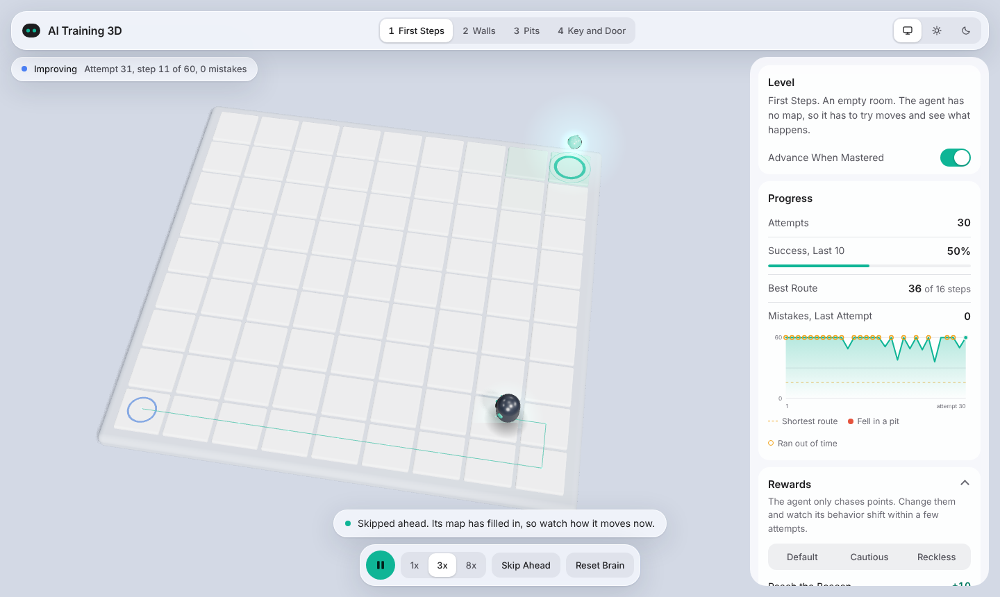
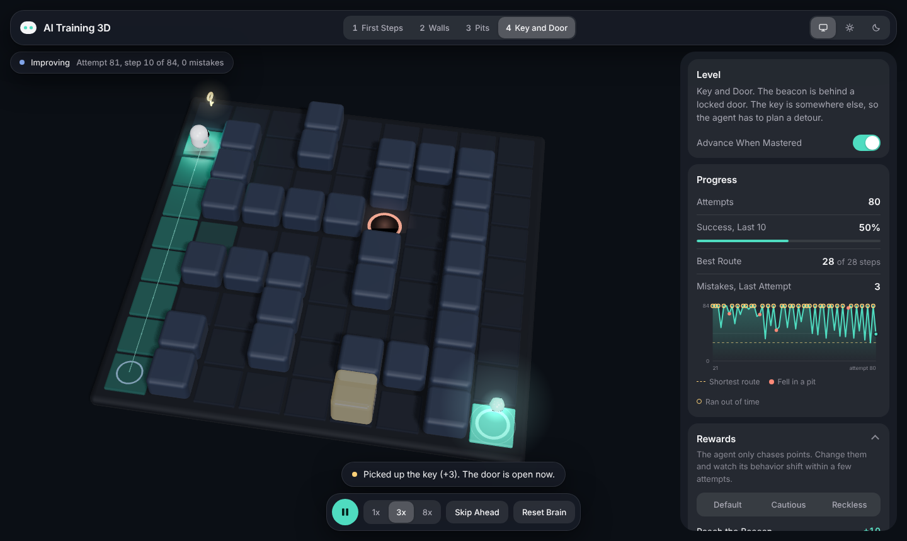
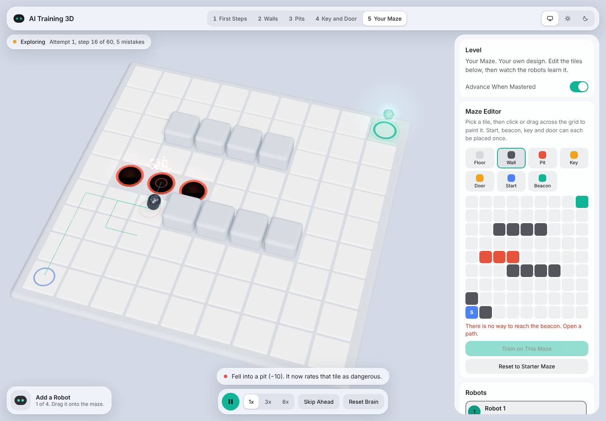
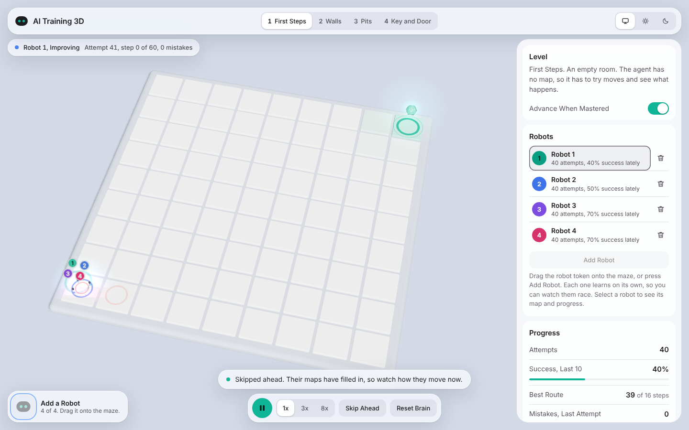
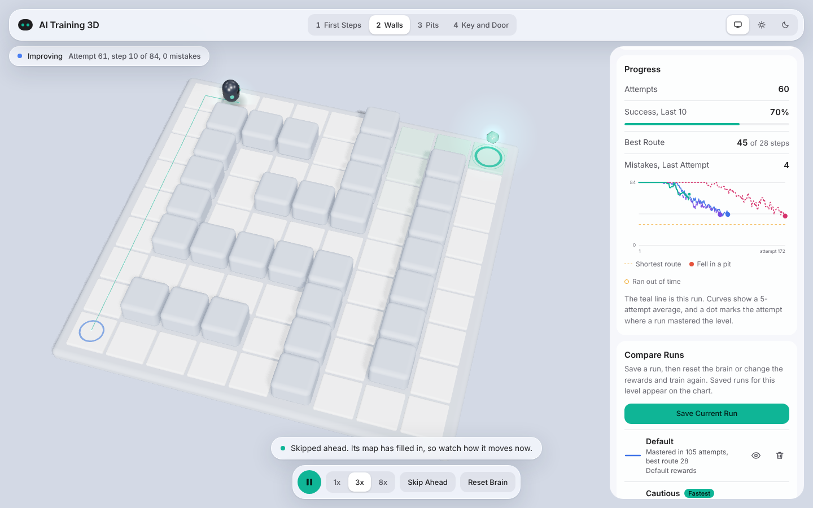

# AI Training 3D

Watch a small 3D robot learn from its mistakes. It starts with no map, bumps into walls, falls into pits, and slowly works out the shortest route to a glowing beacon. Everything runs in your browser, with no backend.

| Light | Dark |
| --- | --- |
|  |  |

## What you can do

- **Watch it learn.** The floor glows brighter where the robot expects reward, and a chart shows steps per attempt falling toward the shortest route.
- **Climb four levels.** First Steps, Walls, Pits, then Key and Door. Each adds one skill, and the robot moves on once it solves a level reliably.
- **Change what it wants.** Edit the reward for reaching the beacon, hitting a wall, falling into a pit and more. The Cautious and Reckless presets show how behavior follows incentives.
- **Compare runs.** Save a run, then reset the brain or change the rewards and train again. Up to four saved runs per level are drawn on one chart, with a dot where each one mastered the level and a tag on the fastest. Runs are kept in your browser.
- **Look around.** Drag the scene to orbit. Pause, change speed, skip ahead 25 attempts, or reset its brain.
- **Light, Dark or System.** The toolbar pins an appearance. The default follows your system.

- **Add more robots by drag and drop.** Drag the robot token from the tray onto the maze (or tap it, or press Add Robot) to drop in another learner, up to four. Each has its own brain, color and number, so you can watch them race on one chart. Select a robot to see its map and progress. Saved runs are for single-robot sessions.

- **Build your own maze.** Level 5, Your Maze, has a 9 by 9 editor. Pick a tile (floor, wall, pit, key, door, start, beacon) and click or drag across the grid to paint it. The editor checks that the beacon can be reached and shows the shortest route before you train on it. Your maze is kept in your browser.







## How the learning works

The robot uses tabular Q-learning. For every tile, whether it holds the key, and each of four moves, it stores one number: the total reward it expects from that move. After each step it nudges that number toward what actually happened.

```
Q(s, a) += alpha * (reward + gamma * max Q(s', a') - Q(s, a))
```

It tries a random move 20% of the time at first, settling to 3%. That curiosity is why early attempts look clumsy. The code is in [`src/core`](src/core) and has no dependency on the 3D view.

A level counts as mastered when at least 9 of the last 10 attempts reach the beacon, averaging no more than 1.5x the shortest route.

## Run it

```bash
npm install
npm run dev      # http://localhost:5173
npm test         # learning tests
npm run build    # static site in dist/
```

## Project layout

```
src/
  core/    levels, custom maze rules, environment, Q-learning agent, mastery rule, saved runs (no DOM)
  view/    three.js scene and light/dark palettes
  ui/      chart and appearance control
  main.js  the loop that connects them
tests/     every level is solvable, the agent masters all four, saved runs behave, several robots learn independently
```

The tests run the agent on 10 random seeds and fail if any seed does not reach mastery on every level.

## Ideas for next

- Move to a small neural network (DQN) with TensorFlow.js
- Moving obstacles and a prompt-to-maze generator
- Share a level and its rewards through a link

## Built with

[three.js](https://threejs.org) and [Vite](https://vitejs.dev).
